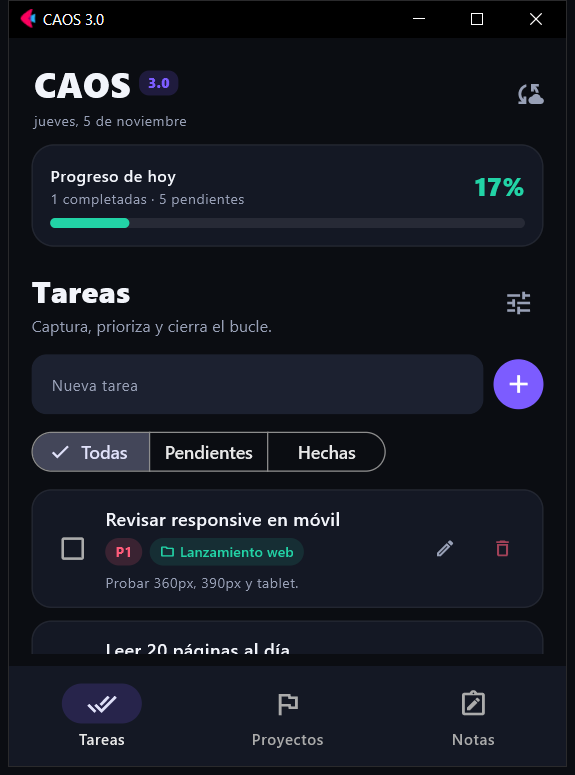
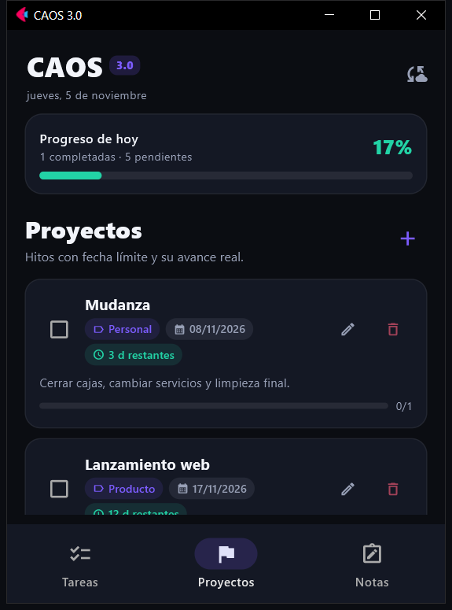
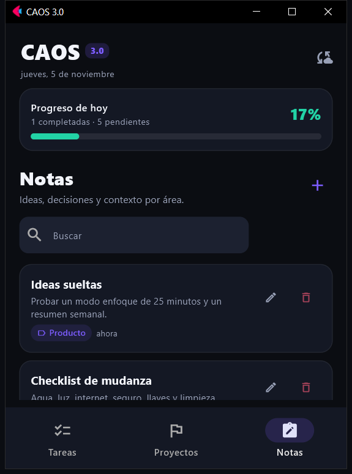

# CAOS 3.0

Sistema de productividad personal **offline-first** para escritorio y Android. Organiza tareas, proyectos con fecha límite y notas, y cierra el ciclo con feedback inmediato al completar una tarea: sonido, animación de la tarjeta y actualización de la barra de progreso diaria.

Construido con **Python + Flet**, **SQLite** local y sincronización con **Turso** por HTTP.





---

## Características

- **Tareas sueltas o vinculadas a proyectos.** Prioridad Eisenhower obligatoria (1–4).
- **Proyectos / deadlines** con fecha límite, área, progreso calculado a partir de sus tareas y desvinculación automática al eliminarlos.
- **Notas** por área, vinculables a un proyecto, con búsqueda por título, contenido y área.
- **Feedback dopaminérgico** al completar: sonido de éxito, microanimación y barra de progreso diaria (`completadas hoy / (completadas hoy + pendientes)`).
- **100 % offline.** SQLite local con IDs UUID v4 generados en la app antes de persistir.
- **Sincronización automática y bidireccional con Turso.** Sube cada cambio local unos 2 segundos después, revisa la red cada 2 minutos, hace una pasada final al pasar a segundo plano o cerrar y baja los cambios de otros dispositivos, sin pulsar nada. También queda el botón manual en el icono de la nube.
- **Resolución de conflictos por `updated_at`** (*last-write-wins*), tanto al subir como al bajar.
- **Borrado lógico** (`deleted`) para poder propagar eliminaciones durante la sincronización.
- **Arquitectura DDD modular**: la UI no toca la base de datos y los casos de uso no contienen SQL.

---

## Arquitectura

```
main.py                     Punto de entrada (composition root de Flet)
requirements*.txt           Dependencias de ejecución, escritorio y desarrollo
src/
├── shared/
│   ├── domain/             Entidad base, errores y value objects compartidos
│   ├── application/        Event bus, sincronización y auto-sync
│   ├── infrastructure/     Database (SQLite), sonda de red y cliente HTTP de Turso
│   └── presentation/       Shell, tema, widgets y efectos (audio/animación)
└── domains/
    ├── tareas/
    │   ├── models/         Tarea, Prioridad y reglas de estado
    │   ├── application/    TareaService + puerto del repositorio
    │   ├── infrastructure/ SqliteTareaRepository
    │   └── presentation/   TareasView (Flet)
    ├── deadlines/          Misma estructura vertical
    └── notas/              Misma estructura vertical
tests/                      Pruebas unitarias e integración con pytest
scripts/                    Utilidades (captura de UI, generación del sonido)
assets/sounds/success.wav   Sonido de éxito
artifacts/                  Capturas de referencia de la UI real
```

Reglas de dependencia:

- `models` no importa Flet ni SQLite.
- `application` orquesta reglas de negocio y depende de puertos (interfaces), nunca de SQL.
- `infrastructure` implementa los puertos con SQLite/Turso.
- `presentation` solo habla con los casos de uso a través de `AppContext` y escucha eventos del `EventBus`.

---

## Requisitos

- **Python 3.10 o superior** (probado en este equipo con Python 3.15).
- **Escritorio:** Windows, macOS o Linux con el cliente de escritorio de Flet.
- **Android (compilación):** `flet-cli` y el toolchain de Android que requiera Flet.
- **Sincronización opcional:** una base de datos Turso y un token válido.

> Si usas una versión muy reciente de Python y `flet-cli` falla al compilar **PyYAML**, instala Python 3.12/3.13 para compilar el APK o instala *Microsoft C++ Build Tools*. La app de escritorio funciona sin `flet-cli`.

---

## Instalación

> Guía paso a paso para Windows, con todos los comandos y solución de problemas: **[`docs.txt`](docs.txt)**.
>
> Guía didáctica del código, archivo por archivo y línea a línea: **[`guide.md`](guide.md)**.

### Escritorio (desarrollo)

```powershell
python -m venv .venv
.\.venv\Scripts\Activate.ps1
python -m pip install --upgrade pip
python -m pip install -r requirements-desktop.txt
```

En macOS/Linux:

```bash
python3 -m venv .venv
source .venv/bin/activate
python -m pip install --upgrade pip
python -m pip install -r requirements-desktop.txt
```

### Desarrollo y pruebas

```powershell
python -m pip install -r requirements-dev.txt
```

`requirements-dev.txt` añade `pytest` y `Pillow` (este último solo para el script de capturas).

---

## Ejecutar la app

```powershell
.\.venv\Scripts\python.exe main.py
```

La app abre una ventana de escritorio. En Android se ejecuta con Flet usando el mismo punto de entrada.

---

## Pruebas

```powershell
.\.venv\Scripts\python.exe -m pytest -q
```

La suite cubre modelos, casos de uso, repositorios SQLite, event bus, sincronización bidireccional, sincronización automática (bucle, debounce y cierre) y sonda de red. Actualmente: **106 pruebas**.

---

## Base de datos local

El archivo local se llama `caos_local.db`. La ruta se resuelve en este orden:

1. `CAOS_DB_PATH` → ruta explícita (útil para demos y pruebas manuales).
2. `FLET_APP_STORAGE_DATA` → `caos_local.db` dentro del almacenamiento privado de la app (Android/iOS).
3. `~/.caos/caos_local.db` en escritorio.

El esquema se crea automáticamente al arrancar (`PRAGMA journal_mode = WAL`, claves foráneas activas, índices para sincronización y consultas).

Ejemplo para usar una base desechable:

```powershell
$env:CAOS_DB_PATH = "$env:TEMP\caos_demo.db"
.\.venv\Scripts\python.exe main.py
```

---

## Sincronización con Turso

### Configurar desde la app (recomendado, también en Android)

1. Abre la app y pulsa el icono de nube en la cabecera.
2. Escribe la **URL** de tu base (`libsql://tu-base.turso.io`) y el **token**.
3. Pulsa **Probar conexión**; si responde bien, pulsa **Guardar**.
4. La sincronización automática empezará en ~1 segundo. Si quieres forzarla, pulsa **Sincronizar ahora**.

Las credenciales se guardan en la tabla `settings` de la base SQLite local (`src/shared/infrastructure/settings_repository.py`), así que sobreviven a reinicios y no dependen de variables de entorno. En Android esta es la única forma de configurarlas.

### Configurar con variables de entorno (escritorio)

```powershell
$env:TURSO_DATABASE_URL = "libsql://tu-base.turso.io"
$env:TURSO_AUTH_TOKEN = "tu-token"
.\.venv\Scripts\python.exe main.py
```

Comportamiento:

- El botón muestra cuántos registros están pendientes por dominio (proyectos, tareas, notas).
- La sincronización es **bidireccional**: primero sube lo local pendiente y después baja los cambios de la nube.
- Es **automática**: cada cambio local se sube ~2 segundos después (con *debounce*), además de una pasada cada 120 segundos, otra al volver a la app y una final al pasar a segundo plano o cerrar. Justo después de guardar las credenciales también se sincroniza. El botón manual sigue disponible.
- En escritorio, si creas algo y cierras la app de inmediato, la ventana espera a que la pasada final suba los pendientes antes de destruirse. En Android, `PAUSE` hace esa pasada final.
- La comprobación de red abre un TCP a `1.1.1.1:443` o `8.8.8.8:443` (`src/shared/infrastructure/connectivity.py`). Si no hay red, no se intenta Turso y se reintenta en la siguiente vuelta.
- Crea las tablas remotas si no existen. El esquema se envía siempre, así que una instalación nueva puede recibir datos aunque no tenga nada que subir.
- Sube **primero proyectos, después tareas y al final notas** para respetar las claves foráneas.
- Solo después de una sincronización correcta se marca `synced = 1` en local.
- Las eliminaciones viajan como borrado lógico (`deleted = 1`) en ambos sentidos.
- Los conflictos se resuelven con **last-write-wins**: gana el registro con el `updated_at` más reciente (UTC). Si la nube tiene una versión más nueva, no se pisa al subir; se baja después.
- Si Turso no está configurado o falla la red, la app sigue funcionando offline y el error queda en el log (o en el diálogo, si la sincronización fue manual).
- La automática y la manual comparten un candado: nunca hablan con Turso a la vez.

Ejemplo con dos dispositivos:

1. En el portátil creas una tarea. La sincronización automática la sube a Turso ~2 segundos después (o pulsas la nube para no esperar). Si cierras la app enseguida, la pasada final la sube antes de salir.
2. En el teléfono abres la app: en ~1 segundo la tarea baja a su SQLite local.
3. Editas la tarea en el teléfono; el debounce de 2 segundos sube la versión nueva.
4. En el portátil, la siguiente pasada automática (hasta 120 s) o volver a la app recibe la edición del teléfono.

> `TURSO_DATABASE_URL` acepta `libsql://...` o una URL `https://...`; se normaliza automáticamente.

---

## Android

1. Instala el CLI de Flet en un entorno compatible:

   ```powershell
   python -m pip install flet-cli==1.1.0
   ```

2. Compila el APK desde la raíz del proyecto:

   ```powershell
   flet build apk
   ```

3. Instala el APK resultante en el dispositivo.

Notas:

- `flet-desktop` es solo para escritorio; no lo incluyas en el entorno de compilación móvil.
- La base local vivirá en el almacenamiento privado de la app (`FLET_APP_STORAGE_DATA`).
- El feedback de audio usa `flet-audio` y cae a un pitido del sistema si el dispositivo no puede reproducir el WAV.
- Para sincronizar con Turso en Android, abre el icono de nube y escribe la URL y el token ahí mismo. No necesitas variables de entorno.
- La sincronización automática funciona mientras la app está abierta: sube cada cambio ~2 segundos después, revisa la red cada 2 minutos, hace una pasada final al pasar a segundo plano o cerrar y otra al volver. Si Android mata la app sin avisar, los cambios pendientes se suben en el siguiente arranque.
- El APK de prueba está firmado con la clave de depuración; sirve para instalar y probar, no para publicar en Play Store.
- La interfaz usa `ft.SafeArea` en `main.py`: Android 15+ dibuja de borde a borde (`targetSdk 36`), y así la cabecera no queda bajo la barra de notificaciones ni la navegación bajo la barra de gestos.

---

## Capturas de UI (opcional, Windows)

`scripts/capture_ui.py` siembra una base de demostración y guarda seis capturas en `artifacts/`:

```powershell
.\.venv\Scripts\python.exe scripts\capture_ui.py
```

Capturas generadas:

| Archivo | Contenido |
| --- | --- |
| `01_tareas.png` | Lista de tareas, progreso diario y filtros |
| `02_proyectos.png` | Proyectos con fecha límite y avance |
| `03_notas.png` | Notas con búsqueda |
| `04_dialogo_tarea.png` | Diálogo de creación de tarea |
| `05_dialogo_proyecto.png` | Diálogo de creación de proyecto |
| `06_sync.png` | Diálogo de sincronización |

El script usa `PIL.ImageGrab` sobre la ventana real (no el modo de captura de Flet, que en Windows maximiza la ventana) y requiere `Pillow`.

También puedes regenerar el sonido de éxito:

```powershell
.\.venv\Scripts\python.exe scripts\generate_sound.py
```

---

## Decisiones de diseño

- **UUID v4 generados en la app**: permiten crear registros offline sin colisiones al sincronizar.
- **Booleanos como enteros** y fechas ISO 8601 en UTC para mantener el esquema simple y compatible con Turso.
- **Borrado lógico**: `deleted` viaja en la sincronización; `synced` indica si falta subir un registro.
- **Progreso diario**: `completadas_hoy / (completadas_hoy + pendientes)`. Las tareas completadas en días anteriores no inflan el porcentaje de hoy.
- **Event bus** para desacoplar dominios: al completar una tarea se actualizan la lista, la barra de progreso y los contadores sin acoplar las vistas.
- **Sincronización automática en primer plano**: un bucle con `page.run_task` y `asyncio.to_thread` revisa la red y sincroniza sin bloquear la UI. Un *debounce* de 2 s reacciona a los cambios locales y una pasada final cubre el cierre o el paso a segundo plano. No se usa un servicio Android en segundo plano para no complicar el ciclo de vida ni el consumo de batería.
- **Feedback tolerante a fallos**: si el audio o la animación fallan, la operación de negocio ya quedó persistida y la UI sigue funcionando.
- **Flet 1.1**: se usa la API actual (`ft.run`, `page.show_dialog`, `page.services`, `ft.Padding`/`ft.Margin`).

---

## Limitaciones conocidas

- La sincronización automática solo funciona con la app abierta (debounce de 2 s, bucle de 2 minutos y pasada final al cerrar/reanudar); no hay un servicio Android en segundo plano.
- La sonda de red es aproximada: comprueba un TCP a `1.1.1.1`/`8.8.8.8`; una red cautiva puede dejar pasar la sonda y bloquear Turso, en cuyo caso se reintenta en la siguiente pasada.
- Resolución de conflictos por *last-write-wins* (`updated_at`), sin fusión campo por campo.
- Un solo usuario por base local.
- Sin autenticación propia: la seguridad de Turso depende del token configurado.
- La captura automática de UI está pensada para Windows (usa APIs nativas de ventana).
